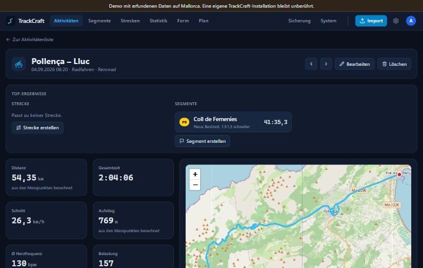
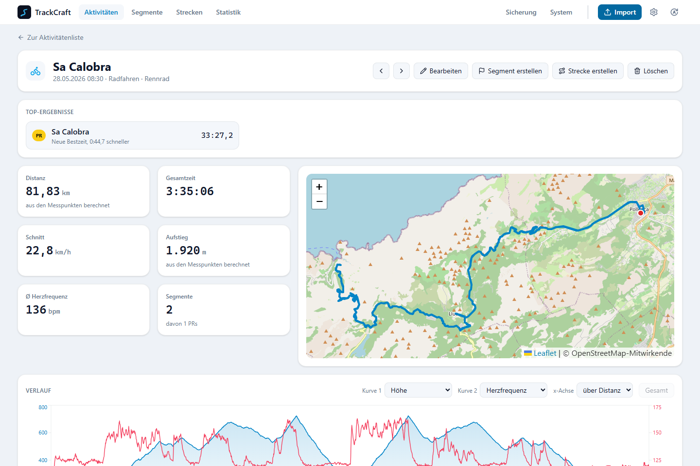
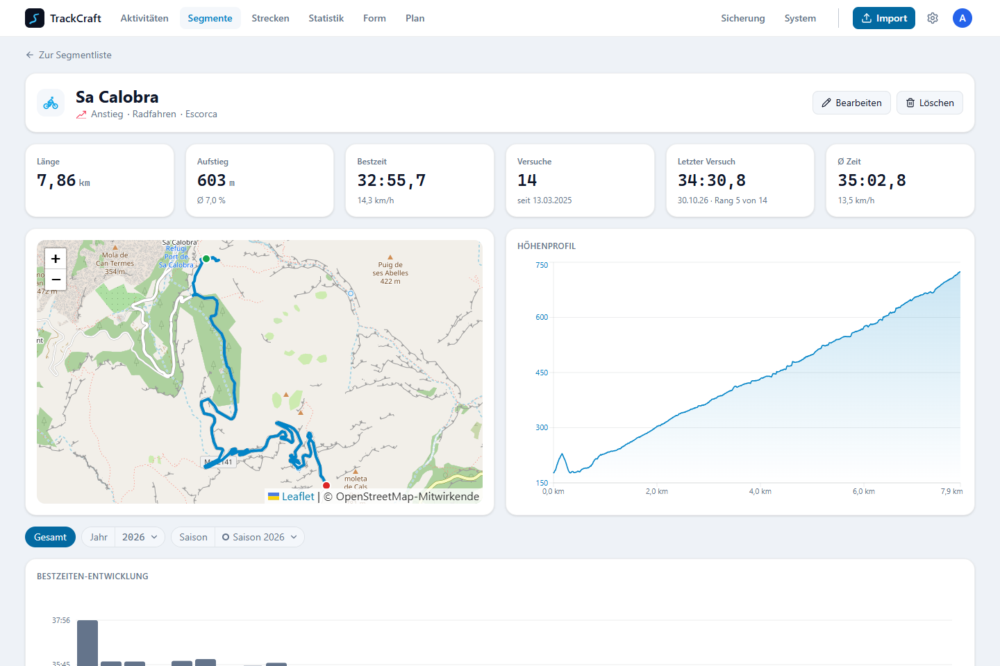
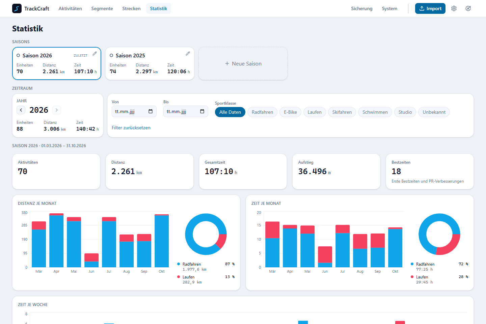
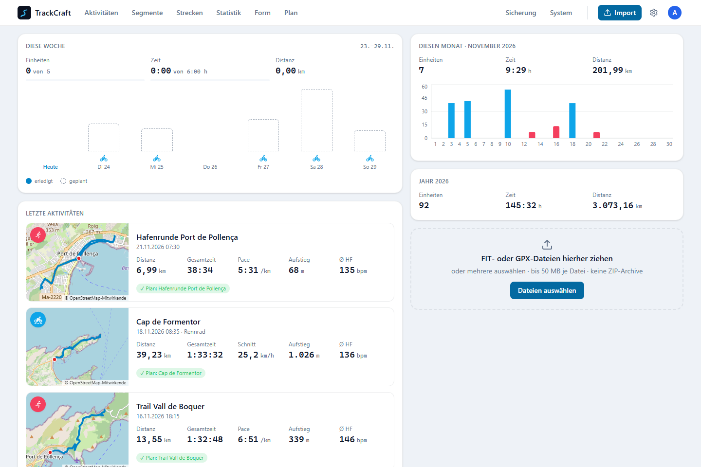
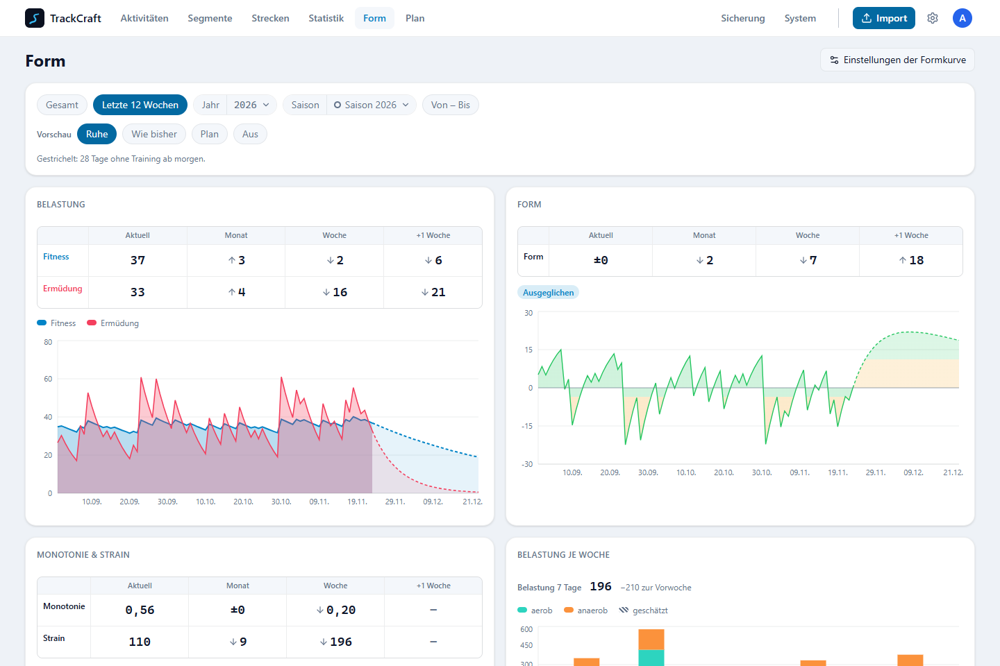

# TrackCraft

<b>Your own segments and leaderboards, like on Strava – matched retroactively across every activity you ever recorded, with Garmin import, no cloud and no subscription.</b>

<a href="README.md">Deutsch</a> · <a href="#try-it">Try it in two minutes</a> · <a href="#installation">Installation</a> · <a href="#faq">FAQ</a>

**Your training data on your own machine.** TrackCraft is a self-hosted training platform for FIT and GPX files: import activities, view them on a map, draw your own segments and routes, track personal bests across years and seasons, follow training load and form, and plan your training up to your next goal. No cloud, no account, inside your home network.

Status: version 0.9 (pre-release on the way to v1.0). **The user interface is available in English and German** (Settings → Appearance, with date and number format chosen separately); the guides for Windows, Linux and Docker are in English and German, the specification in `docs` is German. TrackCraft is built for **one person** in their home network and deliberately has **no login** (see [Security](#security-home-network-only)).

**Try it without installing:** the [demo](#try-it) with made-up rides on Mallorca starts with a double-click on Windows or with a single `docker compose` command.

Mark a segment, save it, done: TrackCraft instantly finds it in every past ride (shown with the German UI).

<picture>
  <source media="(prefers-color-scheme: dark)" srcset="docs/screenshots/aktivitaet-dunkel.png">
  
</picture>

| Segment with leaderboard | Statistics |
| :---: | :---: |
| <picture><source media="(prefers-color-scheme: dark)" srcset="docs/screenshots/segment-dunkel.png"></picture> | <picture><source media="(prefers-color-scheme: dark)" srcset="docs/screenshots/statistik-dunkel.png"></picture> |
| **Dashboard** | **Form** |
| <picture><source media="(prefers-color-scheme: dark)" srcset="docs/screenshots/dashboard-dunkel.png"></picture> | <picture><source media="(prefers-color-scheme: dark)" srcset="docs/screenshots/form-dunkel.png"></picture> |

All screenshots show made-up sample data on Mallorca ([scripts/demo](scripts/demo/README.md)).

## Features

**Import**
- FIT and GPX files by drag and drop, many at once; files without conflicts are saved without asking.
- Detects duplicates, fixes wrong device clocks and remembers rejected files.
- Filters GPS outliers, smooths elevation and detects rides in a car or train.
- **Garmin Connect:** uses the personal Garmin API to fetch your whole history from a start date, then new activities periodically.

**Activities**
- List with filters (sport, period, season, route), sorting and totals.
- Detail page with key figures, OpenStreetMap map and elevation, heart rate and speed profiles with a shared cursor.
- Edit title, sport, place, description and time; an empty place is suggested from your other activities or OpenStreetMap.
- Sports: cycling, e-bike, running, skiing, swimming and gym, with sub-types (road, MTB, trail …) managed in the UI.

**Segments and routes**
- Mark a section directly on an activity's map and save it as a segment or a whole route, also by touch on a tablet.
- TrackCraft finds every segment in all past and future activities, even with GPS drift and gaps.
- Leaderboards overall, per year and per season, with a season-best badge and a history chart.
- Detects loops and warns when a new route matches an existing one.

**Analysis, load and planning**
- Dashboard, statistics over any period, and freely named **seasons** that drive leaderboards, filters and statistics.
- Heart rate zones, training load per activity (Banister TRIMP), and a **Form** page with fitness, fatigue and form plus a forecast.
- Calendar with planned sessions, series, templates and drag and drop; goals such as races, and a **planning assistant** that suggests sessions up to the goal.

**Operations**
- Runs as a Windows service, a Linux systemd service (e.g. in a Proxmox container) or with Docker.
- Own HTTPS with a home-network certificate authority created by the setup.
- Works on desktop, tablet and phone, light and dark theme.
- One SQLite database plus your unchanged original files; every figure can be recomputed from the originals.
- **Export:** all data as ZIP (originals, GPX per activity, data as JSON), original or GPX per activity, and the filtered activity list as CSV.

Ideas for later are described as [issues](../../issues) (in German).

## Security: home network only

TrackCraft v1 has **no login**. Whoever reaches the UI may read, change and delete everything. So TrackCraft belongs in your LAN or behind a VPN such as Tailscale or WireGuard, **never exposed to the internet through port forwarding**. The browser side is protected by HTTPS, host and origin checks and a strict Content Security Policy. Please report vulnerabilities as described in [SECURITY.md](SECURITY.md).

## Try it

A demo with the made-up Mallorca data runs on your own machine without installation. The data is shifted on start so that the last activity was yesterday; a banner marks it as a demo. An existing TrackCraft installation is not touched.

- **Windows:** unzip `trackcraft-<version>-windows-demo.zip` from the [latest release](https://github.com/ulilaun/trackcraft/releases/latest) and double-click `demo.cmd`. No administrator rights needed; the browser opens <https://localhost:8443>. Details in `DEMO.en.md`.
- **Docker:** take `compose.demo.yaml` from `trackcraft-<version>-docker.zip`, run `docker compose -f compose.demo.yaml up` and open <https://localhost:8443>. Remove everything with `docker compose -f compose.demo.yaml down -v`.

**Certificate warning:** the browser warns on first access. That is expected for the demo, which creates its own certificate on first start. Continue via **Advanced** and **Proceed to localhost**, for this demo address only. A real [installation](#installation) does not show this warning.

## Installation

Packages are available under [Releases](../../releases), each with `SHA256SUMS.txt`. Every package contains its guide in English (`BETRIEB.en.md`) and German (`BETRIEB.md`).

| Platform | Requirements | Package | Guide |
| :--- | :--- | :--- | :--- |
| Windows | Windows 11, x86-64, 2 GB free RAM | `trackcraft-<version>-windows-x86_64.zip`, run `setup.cmd` | [infrastructure/windows/BETRIEB.en.md](infrastructure/windows/BETRIEB.en.md) |
| Linux | x86-64 with systemd and glibc ≥ 2.35 (e.g. Debian 12/13, Ubuntu 22.04+), 1 GB free RAM | `trackcraft-<version>-linux-x86_64.tar.gz`, run `setup.sh` | [infrastructure/linux/BETRIEB.en.md](infrastructure/linux/BETRIEB.en.md) |
| Docker | x86-64 host with Docker Engine and the Compose plugin, a reverse proxy for HTTPS in front | `trackcraft-<version>-docker.zip` with `compose.yaml`; images `ghcr.io/ulilaun/trackcraft-backend` and `-frontend`, public | [infrastructure/docker/BETRIEB.en.md](infrastructure/docker/BETRIEB.en.md) |

On Windows and Linux the setup asks for the machine's name in your home network (e.g. `trackcraft.home.arpa`), creates certificates and configuration and starts the service. An update is the same setup from the newer package; the database is migrated automatically.

**Map tiles:** by default the browser loads tiles from the OpenStreetMap Foundation (`tile.openstreetmap.org`), which is meant for occasional private use under their [tile usage policy](https://operations.osmfoundation.org/policies/tiles/). Heavy users configure their own tile provider in `[maps]`.

## FAQ

**Why is there no login?**
A deliberate choice for v1: TrackCraft is built for one person on their own network. Reach it on the go through a VPN like Tailscale or WireGuard, not through port forwarding. That keeps the attack surface small and there is no password to lose. Multiple users with login are described as a [possible extension](../../issues/39).

**Is this a Strava replacement?**
For your own analysis, yes: segments, leaderboards, statistics, form and planning. For the social part, no – there are no friends, kudos or public leaderboards. Your segments only apply to your own activities, but retroactively to all of them, including those from ten years ago.

**How do I get my old activities in?**
Via Garmin Connect (personal API key, fetches your whole history) or as FIT and GPX files by drag and drop, for example from another platform's data export (unpack compressed files first). TrackCraft detects duplicates itself.

**How do I back up my data?**
Everything lives in one data folder: a SQLite database and your unchanged original files. TrackCraft backs up both daily to a backup target of your choice (USB drive, second disk or network share), only when something changed, and keeps the last five backups (time and number adjustable); additionally before every schema migration. Restore works on the Backup page. All data as ZIP is under Settings → Export.

**What leaves my network?**
Only map tile requests (browser → OpenStreetMap or your provider), the optional place suggestion (server → Nominatim, rounded start coordinate, can be switched off) and, if configured, the Garmin Connect download. No telemetry, no accounts, no cloud.

**Does it run on a Raspberry Pi or NAS?**
Officially on x86-64 so far (Windows, Linux, Docker). A small Proxmox container with Debian is plenty; arm64 for the Raspberry Pi is described as a [possible extension](../../issues/7).

## Questions, bugs and contributions

TrackCraft is a hobby project with one maintainer. Questions, bugs and ideas are welcome as [issues](../../issues), in English or German. Please discuss code contributions in an issue first, see [CONTRIBUTING.md](CONTRIBUTING.md).

## Development

Rust backend (Axum, SQLx/SQLite, rustls) and React frontend (React 19, TypeScript, Vite, Tailwind, Leaflet, Recharts). The specification in [docs](docs/README.md) (ADRs, RFCs, OpenAPI contract) is binding: behaviour changes go into the relevant RFC first. Build and test commands are listed in the [German README](README.md#entwicklung).

## License

TrackCraft is licensed under the [GNU Affero General Public License v3.0 or later](LICENSE). Map data © [OpenStreetMap](https://www.openstreetmap.org/copyright) contributors (ODbL).
