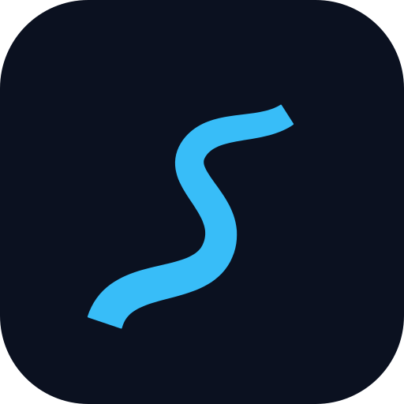
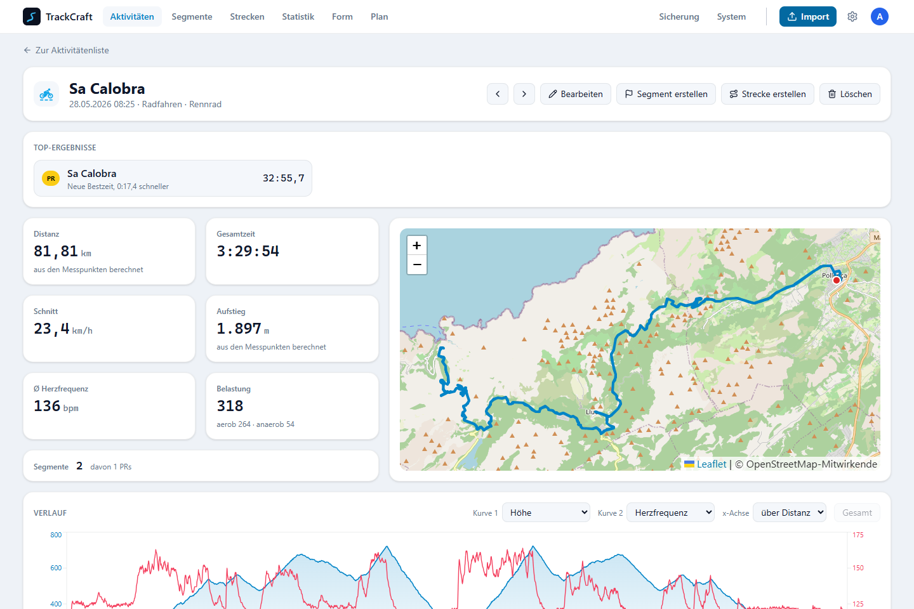
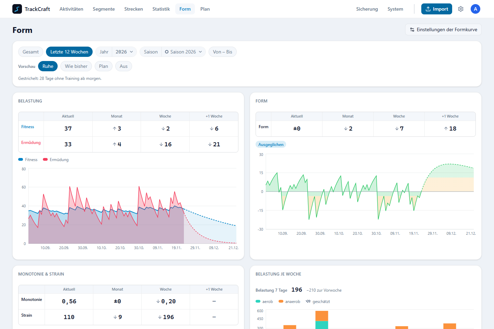
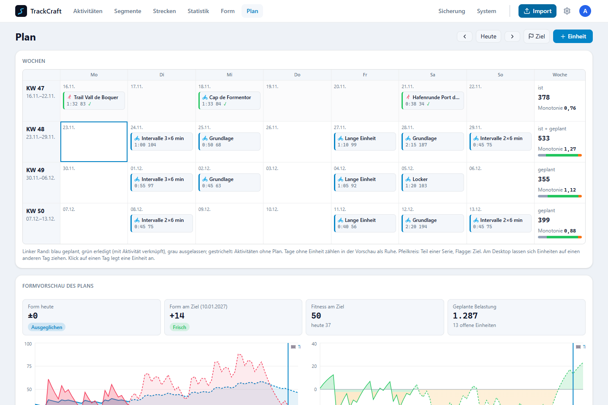

<p align="center"></p>

# TrackCraft

**Deine Trainingsdaten auf deinem eigenen Rechner.** TrackCraft ist eine selbst gehostete Trainingsplattform für FIT- und GPX-Dateien: Aktivitäten importieren, auf der Karte ansehen, eigene Segmente und Strecken anlegen, Bestzeiten über Jahre und Saisons verfolgen, Belastung und Form beobachten und das Training bis zum nächsten Ziel planen. Ohne Cloud, ohne Konto, im eigenen Heimnetz.

Stand: Version 0.8 (Vorabversion auf dem Weg zu v1.0). Oberfläche und Dokumentation sind auf Deutsch. TrackCraft ist für **eine Person** im eigenen Heimnetz gedacht und hat **kein Login** (siehe [Sicherheit](#sicherheit-nur-fürs-heimnetz)).

<picture>
  <source media="(prefers-color-scheme: dark)" srcset="docs/screenshots/aktivitaet-dunkel.png">
  
</picture>

| Segment mit Bestenliste | Statistik |
| :---: | :---: |
| <picture><source media="(prefers-color-scheme: dark)" srcset="docs/screenshots/segment-dunkel.png"></picture> | <picture><source media="(prefers-color-scheme: dark)" srcset="docs/screenshots/statistik-dunkel.png"></picture> |
| **Dashboard** | **Aktivitätenliste** |
| <picture><source media="(prefers-color-scheme: dark)" srcset="docs/screenshots/dashboard-dunkel.png"></picture> | <picture><source media="(prefers-color-scheme: dark)" srcset="docs/screenshots/aktivitaeten-dunkel.png"></picture> |
| **Form** | **Plan** |
| <picture><source media="(prefers-color-scheme: dark)" srcset="docs/screenshots/form-dunkel.png"></picture> | <picture><source media="(prefers-color-scheme: dark)" srcset="docs/screenshots/plan-dunkel.png"></picture> |

Alle Bilder zeigen erfundene Beispieldaten auf Mallorca ([scripts/demo](scripts/demo/README.md)); eine Tablet-Ansicht liegt unter [docs/screenshots](docs/screenshots).

## Was TrackCraft heute kann

**Import**
- FIT- und GPX-Dateien per Drag-and-drop, viele auf einmal; Dateien ohne Konflikt werden ohne Rückfrage gespeichert.
- Erkennt Duplikate, korrigiert falsche Gerätezeiten und merkt sich abgelehnte Dateien.
- Filtert GPS-Ausreißer, glättet die Höhe und erkennt Fahrten im Auto oder Zug.
- Liest auch FIT-Dateien mit falscher Prüfsumme, solange sie lesbar sind.
- **Garmin Connect:** holt mit der persönlichen Garmin-API alle Aktivitäten ab einem Startdatum und danach regelmäßig die neuen (mit Fortschrittsanzeige).

**Aktivitäten**
- Liste mit Filtern (Sportklasse, Zeitraum, Saison, Strecke), Sortierung und Summenzeile.
- Detailseite mit Kennzahlen, Karte (OpenStreetMap) und Höhen-, Puls- und Geschwindigkeitsprofil, beide mit gemeinsamer Markierung.
- Titel, Sportart, Ort, Beschreibung und Zeit bearbeiten; ein leerer Ort wird aus deinen anderen Aktivitäten oder per OpenStreetMap vorgeschlagen. Löschen mit Vorschau, was dabei wegfällt.
- Sportklassen Radfahren, E-Bike, Laufen, Skifahren, Schwimmen und Studio, Untertypen (z. B. Rennrad, MTB, Trail) in der Oberfläche pflegbar.

**Segmente und Strecken**
- Abschnitt direkt auf der Karte einer Aktivität markieren und als Segment oder ganze Strecke speichern, auch auf dem Tablet per Touch.
- TrackCraft findet jedes Segment in allen bisherigen und künftigen Aktivitäten wieder, auch bei GPS-Versatz und Lücken.
- Bestenlisten gesamt, je Jahr und je Saison, mit Plakette für die Saisonbestzeit und Verlaufsdiagramm.
- Erkennt Rundkurse und warnt, wenn eine neue Strecke einer vorhandenen gleicht.

**Auswertung**
- Dashboard mit den letzten Aktivitäten samt Kartenvorschau, der laufenden Woche (erledigt gegen geplant), Monat und Jahr.
- Statistikseite mit Summen und Verteilung je Sportklasse über frei wählbare Zeiträume.
- **Saisons:** frei benannte Zeiträume (z. B. „Sommer 2026“), in der Oberfläche gepflegt, wirken auf Bestenlisten, Filter und Statistik.

**Belastung und Form**
- Herzfrequenzzonen im Konto, allgemein oder je Sportklasse und mit Gültigkeitsdatum; die maximale HF wird aus dem Geburtstag vorgeschlagen.
- Belastung je Aktivität aus der Herzfrequenz (TRIMP nach Banister) und Zeit in den Zonen; ohne Pulsdaten geschätzt und so gekennzeichnet.
- Seite **Form** mit Fitness, Ermüdung und Form über die Zeit und einer Vorschau (Ruhe, gleichbleibend oder nach Plan); Modell wählbar, jede Einstellung mit Erklärung.

**Planung**
- Kalender mit geplanten Einheiten (Zielbelastung oder Minuten je Zone), Serien, Vorlagen und Verschieben per Drag-and-drop.
- Ziele wie Wettkämpfe oder Touren im Kalender; die **Planungshilfe** schlägt die Einheiten bis zum Ziel vor (Minuten je Wochentag, Steigerung, Entlastungswochen).
- Eine Aktivität lässt sich der geplanten Einheit des Tages zuordnen (TrackCraft schlägt sie vor); die Formvorschau rechnet den offenen Plan mit ein.

**Betrieb**
- Läuft als Windows-Dienst, als Linux-systemd-Dienst (z. B. in einem Proxmox-Container) oder mit Docker.
- Eigenes HTTPS mit einer Heimnetz-Zertifizierungsstelle, die das Setup anlegt; Handy und Tablet vertrauen ihr nach einmaligem Import.
- Bedienbar am PC, Tablet und Handy, helles und dunkles Design.
- Eine Datenbank (SQLite) und die unveränderten Originaldateien; jede Kennzahl lässt sich aus den Originalen neu berechnen.

**Noch nicht enthalten** (geplant bis v1.0): tägliche Sicherung und Wiederherstellung aus der Oberfläche, Export. Später denkbar und als [Issues](../../issues) beschrieben: Ausrüstung und Wartung, Leistungsdaten (Watt), Laufprognosen, Gesundheitsdaten, mehrere Benutzer mit Anmeldung, weitere Sprachen, Raspberry Pi, MCP-Server.

## Sicherheit: nur fürs Heimnetz

TrackCraft hat in V1 **kein Login**. Wer die Oberfläche erreicht, darf alles lesen, ändern und löschen. Deshalb gehört TrackCraft ins eigene LAN oder hinter ein VPN (z. B. Tailscale oder WireGuard), **nie per Portfreigabe ins Internet**. Schutz im Browser über HTTPS, Host- und Origin-Prüfung und eine strenge Content-Security-Policy (ADR-0012, RFC-0011). Sicherheitslücken bitte wie in [SECURITY.md](SECURITY.md) beschrieben melden.

## Installation

Fertige Pakete gibt es unter [Releases](../../releases), jeweils mit `SHA256SUMS.txt`.

| Plattform | Voraussetzungen | Paket | Anleitung |
| :--- | :--- | :--- | :--- |
| Windows | Windows 11, x86-64, 2 GB freier Arbeitsspeicher | `trackcraft-<version>-windows-x86_64.zip`, Start über `setup.cmd` | [infrastructure/windows/BETRIEB.md](infrastructure/windows/BETRIEB.md) |
| Linux | x86-64 mit systemd und glibc ≥ 2.35 (z. B. Debian 12/13, Ubuntu 22.04 und neuer), 1 GB freier Arbeitsspeicher | `trackcraft-<version>-linux-x86_64.tar.gz`, Start über `setup.sh` | [infrastructure/linux/BETRIEB.md](infrastructure/linux/BETRIEB.md) |
| Docker | x86-64-Host mit Docker Engine und Compose v2, davor ein Reverse Proxy für HTTPS | `trackcraft-<version>-docker.zip` mit `compose.yaml`; Images `ghcr.io/ulilaun/trackcraft-backend` und `-frontend`, ohne Anmeldung ladbar | [infrastructure/docker/BETRIEB.md](infrastructure/docker/BETRIEB.md) |

Unter Windows und Linux fragt das Setup nach dem Namen des Rechners im Heimnetz (z. B. `trackcraft.home.arpa`), legt Zertifikate und Konfiguration an und startet den Dienst. Ein Update ist dasselbe Setup aus dem neueren Paket; die Datenbank wird dabei automatisch migriert. Im Browser genügt eine aktuelle Version von Firefox, Chrome, Edge oder Safari.

**Kartenkacheln:** Ohne eigene Einstellung lädt der Browser die Karten direkt von den Servern der OpenStreetMap Foundation (`tile.openstreetmap.org`). Das ist für gelegentliche private Nutzung gedacht und unterliegt deren [Nutzungsrichtlinie](https://operations.osmfoundation.org/policies/tiles/), die Namensnennung blendet TrackCraft ein. Wer viel lädt oder TrackCraft für mehrere Personen betreibt, trägt in der Konfiguration einen eigenen Kachelanbieter ein:

```toml
[maps]
tile_url    = "https://tiles.example.org/{z}/{x}/{y}.png"
attribution = "© OpenStreetMap-Mitwirkende, Kacheln: Beispielanbieter"
```

**Ortsvorschlag:** Findet TrackCraft keinen bekannten Ort in der Nähe des Starts, fragt der Server den Dienst Nominatim von OpenStreetMap (`nominatim.openstreetmap.org`) mit der auf gut 10 m gerundeten Startkoordinate. Das lässt sich unter Einstellungen → Orte abschalten; mit `[places] nominatim_url` geht auch eine eigene Nominatim-Instanz.

## Fragen, Fehler und Beiträge

TrackCraft ist ein Freizeitprojekt mit einem Betreuer. Fragen, Fehler und Ideen bitte als [Issue](../../issues) melden, gern mit Version (Seite System) und Plattform; Sicherheitslücken vertraulich wie in [SECURITY.md](SECURITY.md). Code-Beiträge bitte erst im Issue absprechen, Einzelheiten in [CONTRIBUTING.md](CONTRIBUTING.md).

## Entwicklung

Rust-Backend (Axum, SQLx/SQLite, rustls) und React-Frontend (React 19, TypeScript, Vite, Tailwind, Leaflet, Recharts). Unter Windows mit Rust stable (MSVC) und Node 24:

```powershell
cd backend; cargo fmt --check; cargo clippy --all-targets -- -D warnings; cargo test
cd frontend; npm ci; npm run lint; npm test; npm run build
```

Lokal ausprobieren: eine TOML mit `listen = "127.0.0.1:8443"`, `[tls]` und `allowed_origins = ["https://localhost:5173"]` anlegen, `TRACKCRAFT_CONFIG` darauf zeigen lassen und `cargo run` im Ordner `backend` starten. Dann `npm run dev` im Ordner `frontend` und `http://localhost:5173` öffnen; Vite leitet `/api` an das Backend weiter.

| Ordner | Inhalt |
| :--- | :--- |
| `backend/` | Rust/Axum, Programm `trackcraft` (RFC-0004, RFC-0007) |
| `frontend/` | React/TypeScript/Vite/Tailwind (RFC-0006) |
| `infrastructure/` | Betriebsanleitungen, Setup-Skripte, Dockerfiles, Compose |
| `scripts/` | Windows- und Linux-Paket, Coverage-Auswertung, Beispieldaten und Screenshots (`scripts/demo`) |
| `docs/` | [Spezifikation](docs/README.md): ADRs, RFCs, [OpenAPI-Vertrag](docs/api/openapi.yaml) |
| `.github/workflows/` | `ci` (Pull Requests), `release` (Tags `v*`), `linux-package` |

Die Spezifikation ist verbindlich (Spec first): Änderungen am Verhalten stehen zuerst im zugehörigen RFC. Echte Trainingsdateien enthalten Positionen und liegen nie im Repository; Tests mit eigenen Dateien laufen nur lokal über `TRACKCRAFT_TEST_CORPUS` (RFC-0014).

## Lizenz

TrackCraft steht unter der [GNU Affero General Public License v3.0 oder später](LICENSE). Kartendaten © [OpenStreetMap](https://www.openstreetmap.org/copyright)-Mitwirkende (ODbL). Lizenzen der Abhängigkeiten liegen jedem Paket als `THIRD-PARTY-LICENSES.txt` bei.
