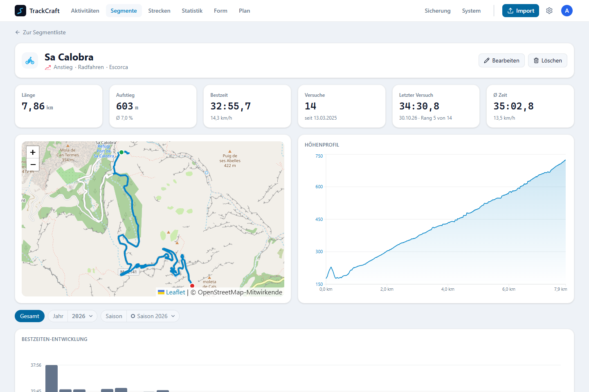
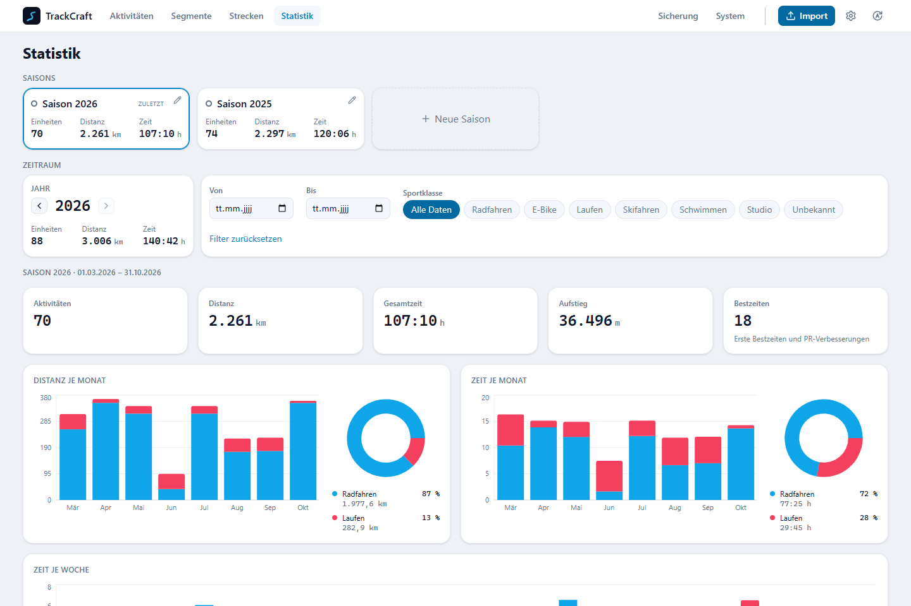
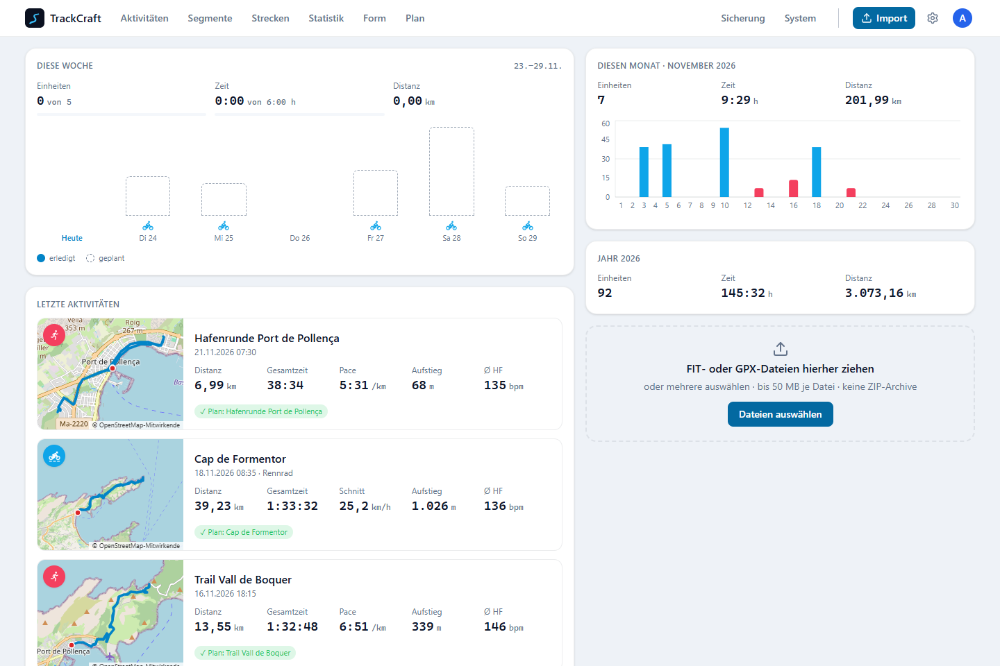
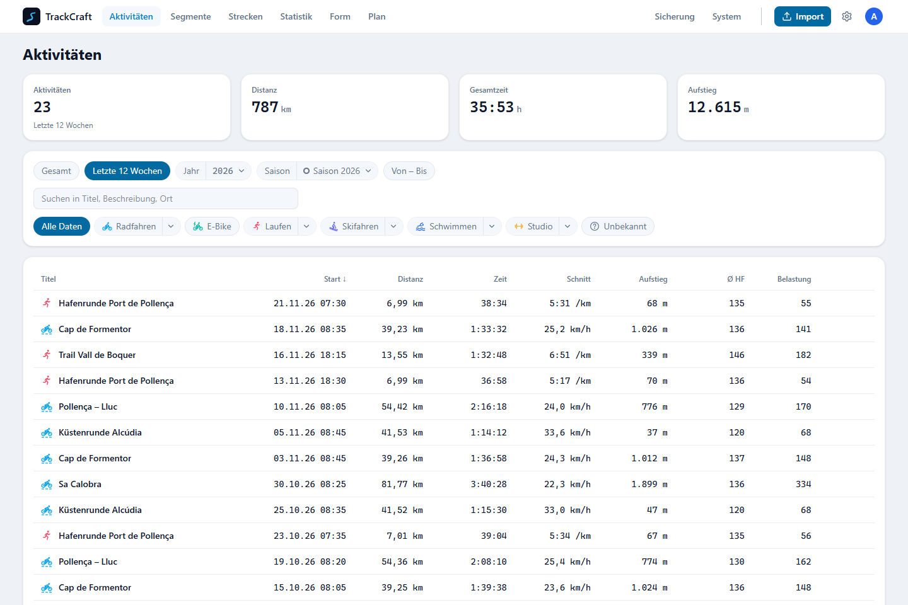

<p align="center"></p>

# TrackCraft

**Deine Trainingsdaten auf deinem eigenen Rechner.** TrackCraft ist eine selbst gehostete Trainingsplattform für FIT- und GPX-Dateien: Aktivitäten importieren, auf der Karte ansehen, eigene Segmente und Strecken anlegen und die eigenen Bestzeiten über Jahre und Saisons verfolgen. Ohne Cloud, ohne Konto, im eigenen Heimnetz.

Stand: Version 0.6 (Vorabversion auf dem Weg zu v1.0). Oberfläche und Dokumentation sind auf Deutsch.

<picture>
  <source media="(prefers-color-scheme: dark)" srcset="docs/screenshots/aktivitaet-dunkel.png">
  
</picture>

| Segment mit Bestenliste | Statistik |
| :---: | :---: |
| <picture><source media="(prefers-color-scheme: dark)" srcset="docs/screenshots/segment-dunkel.png"></picture> | <picture><source media="(prefers-color-scheme: dark)" srcset="docs/screenshots/statistik-dunkel.png"></picture> |
| **Dashboard** | **Aktivitätenliste** |
| <picture><source media="(prefers-color-scheme: dark)" srcset="docs/screenshots/dashboard-dunkel.png"></picture> | <picture><source media="(prefers-color-scheme: dark)" srcset="docs/screenshots/aktivitaeten-dunkel.png"></picture> |

Alle Bilder zeigen erfundene Beispieldaten auf Mallorca ([scripts/demo](scripts/demo/README.md)); eine Tablet-Ansicht liegt unter [docs/screenshots](docs/screenshots).

## Was TrackCraft heute kann

**Import**
- FIT- und GPX-Dateien per Drag-and-drop, viele auf einmal; Dateien ohne Konflikt werden ohne Rückfrage gespeichert.
- Erkennt Duplikate, korrigiert falsche Gerätezeiten und merkt sich abgelehnte Dateien.
- Filtert GPS-Ausreißer, glättet die Höhe und erkennt Fahrten im Auto oder Zug.
- Liest auch FIT-Dateien mit falscher Prüfsumme, solange sie lesbar sind.
- **Garmin Connect:** holt mit der persönlichen Garmin-API alle Aktivitäten ab einem Startdatum und danach regelmäßig die neuen (mit Fortschrittsanzeige).

**Aktivitäten**
- Liste mit Filtern (Sportklasse, Zeitraum, Saison, Strecke), Sortierung und Summenzeile.
- Detailseite mit Kennzahlen, Karte (OpenStreetMap) und Höhen-, Puls- und Geschwindigkeitsprofil, beide mit gemeinsamer Markierung.
- Titel, Sportart, Ort, Beschreibung und Zeit bearbeiten; ein leerer Ort wird aus deinen anderen Aktivitäten oder per OpenStreetMap vorgeschlagen. Löschen mit Vorschau, was dabei wegfällt.
- Sportklassen Radfahren, E-Bike, Laufen, Skifahren, Schwimmen und Studio, Untertypen (z. B. Rennrad, MTB, Trail) in der Oberfläche pflegbar.

**Segmente und Strecken**
- Abschnitt direkt auf der Karte einer Aktivität markieren und als Segment oder ganze Strecke speichern, auch auf dem Tablet per Touch.
- TrackCraft findet jedes Segment in allen bisherigen und künftigen Aktivitäten wieder, auch bei GPS-Versatz und Lücken.
- Bestenlisten gesamt, je Jahr und je Saison, mit Plakette für die Saisonbestzeit und Verlaufsdiagramm.
- Erkennt Rundkurse und warnt, wenn eine neue Strecke einer vorhandenen gleicht.

**Auswertung**
- Dashboard mit den letzten Aktivitäten, Tagesbalken und laufender Saison.
- Statistikseite mit Summen und Verteilung je Sportklasse über frei wählbare Zeiträume.
- **Saisons:** frei benannte Zeiträume (z. B. „Sommer 2026“), in der Oberfläche gepflegt, wirken auf Bestenlisten, Filter und Dashboard.

**Betrieb**
- Läuft als Windows-Dienst, als Linux-systemd-Dienst (z. B. in einem Proxmox-Container) oder mit Docker.
- Eigenes HTTPS mit einer Heimnetz-Zertifizierungsstelle, die das Setup anlegt; Handy und Tablet vertrauen ihr nach einmaligem Import.
- Bedienbar am PC, Tablet und Handy, helles und dunkles Design.
- Eine Datenbank (SQLite) und die unveränderten Originaldateien; jede Kennzahl lässt sich aus den Originalen neu berechnen.

**Noch nicht enthalten** (geplant bis v1.0): Sicherung und Wiederherstellung aus der Oberfläche, Export, Ausrüstung und Wartung. Später denkbar: Gesundheitsdaten, Raspberry Pi, MCP-Server.

## Sicherheit: nur fürs Heimnetz

TrackCraft hat in V1 **kein Login**. Wer die Oberfläche erreicht, darf alles lesen, ändern und löschen. Deshalb gehört TrackCraft ins eigene LAN oder hinter ein VPN (z. B. Tailscale oder WireGuard), **nie per Portfreigabe ins Internet**. Schutz im Browser über HTTPS, Host- und Origin-Prüfung und eine strenge Content-Security-Policy (ADR-0012, RFC-0011). Sicherheitslücken bitte wie in [SECURITY.md](SECURITY.md) beschrieben melden.

## Installation

Fertige Pakete gibt es unter [Releases](../../releases), jeweils mit `SHA256SUMS.txt`.

| Plattform | Paket | Anleitung |
| :--- | :--- | :--- |
| Windows 11 (x86-64) | `trackcraft-<version>-windows-x86_64.zip`, Start über `setup.cmd` | [infrastructure/windows/BETRIEB.md](infrastructure/windows/BETRIEB.md) |
| Linux mit systemd (x86-64, glibc ≥ 2.35) | `trackcraft-<version>-linux-x86_64.tar.gz`, Start über `setup.sh` | [infrastructure/linux/BETRIEB.md](infrastructure/linux/BETRIEB.md) |
| Docker | Images `trackcraft-backend` und `trackcraft-frontend` (GHCR), `compose.yaml` | [infrastructure/docker/BETRIEB.md](infrastructure/docker/BETRIEB.md) |

Das Setup fragt nach dem Namen des Rechners im Heimnetz (z. B. `trackcraft.home.arpa`), legt Zertifikate und Konfiguration an und startet den Dienst. Ein Update ist dasselbe Setup aus dem neueren Paket; die Datenbank wird dabei automatisch migriert.

**Kartenkacheln:** Ohne eigene Einstellung lädt der Browser die Karten direkt von den Servern der OpenStreetMap Foundation (`tile.openstreetmap.org`). Das ist für gelegentliche private Nutzung gedacht und unterliegt deren [Nutzungsrichtlinie](https://operations.osmfoundation.org/policies/tiles/), die Namensnennung blendet TrackCraft ein. Wer viel lädt oder TrackCraft für mehrere Personen betreibt, trägt in der Konfiguration einen eigenen Kachelanbieter ein:

```toml
[maps]
tile_url    = "https://tiles.example.org/{z}/{x}/{y}.png"
attribution = "© OpenStreetMap-Mitwirkende, Kacheln: Beispielanbieter"
```

**Ortsvorschlag:** Findet TrackCraft keinen bekannten Ort in der Nähe des Starts, fragt der Server den Dienst Nominatim von OpenStreetMap (`nominatim.openstreetmap.org`) mit der auf gut 10 m gerundeten Startkoordinate. Das lässt sich unter Einstellungen → Orte abschalten; mit `[places] nominatim_url` geht auch eine eigene Nominatim-Instanz.

## Entwicklung

Rust-Backend (Axum, SQLx/SQLite, rustls) und React-Frontend (React 19, TypeScript, Vite, Tailwind, Leaflet, Recharts). Unter Windows mit Rust stable (MSVC) und Node 24:

```powershell
cd backend; cargo fmt --check; cargo clippy --all-targets -- -D warnings; cargo test
cd frontend; npm ci; npm run lint; npm test; npm run build
```

Lokal ausprobieren: eine TOML mit `listen = "127.0.0.1:8443"`, `[tls]` und `allowed_origins = ["https://localhost:5173"]` anlegen, `TRACKCRAFT_CONFIG` darauf zeigen lassen und `cargo run` im Ordner `backend` starten. Dann `npm run dev` im Ordner `frontend` und `http://localhost:5173` öffnen; Vite leitet `/api` an das Backend weiter.

| Ordner | Inhalt |
| :--- | :--- |
| `backend/` | Rust/Axum, Programm `trackcraft` (RFC-0004, RFC-0007) |
| `frontend/` | React/TypeScript/Vite/Tailwind (RFC-0006) |
| `infrastructure/` | Betriebsanleitungen, Setup-Skripte, Dockerfiles, Compose |
| `scripts/` | Windows- und Linux-Paket, Coverage-Auswertung, Beispieldaten und Screenshots (`scripts/demo`) |
| `docs/` | [Spezifikation](docs/README.md): ADRs, RFCs, [OpenAPI-Vertrag](docs/api/openapi.yaml) |
| `.github/workflows/` | `ci` (Pull Requests), `release` (Tags `v*`), `linux-package` |

Die Spezifikation ist verbindlich (Spec first): Änderungen am Verhalten stehen zuerst im zugehörigen RFC. Echte Trainingsdateien enthalten Positionen und liegen nie im Repository; Tests mit eigenen Dateien laufen nur lokal über `TRACKCRAFT_TEST_CORPUS` (RFC-0014).

## Lizenz

TrackCraft steht unter der [GNU Affero General Public License v3.0 oder später](LICENSE). Kartendaten © [OpenStreetMap](https://www.openstreetmap.org/copyright)-Mitwirkende (ODbL). Lizenzen der Abhängigkeiten liegen jedem Paket als `THIRD-PARTY-LICENSES.txt` bei.
